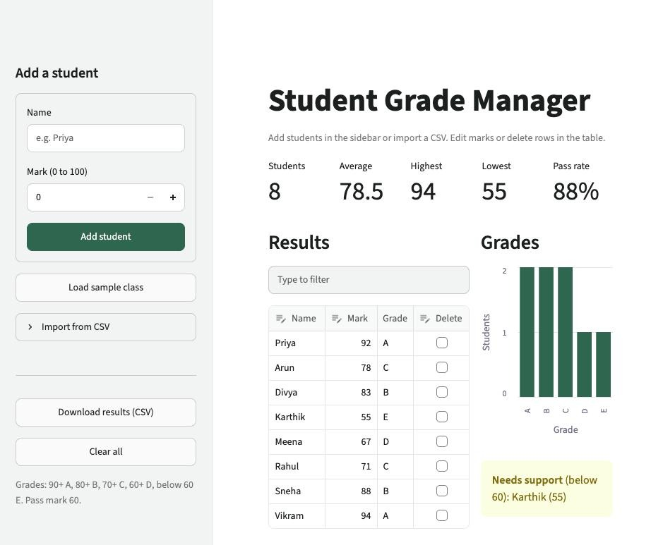

# Week 1 project: Student Grade Manager

A Streamlit app for a teacher to record marks, see grades and class statistics, and spot students who need support. It grows the Day 2 command-line program and the Day 4 page into a complete tool.



## What it does

- **Add students** from the sidebar form. An empty name is rejected and the mark box accepts 0 to 100 only.
- **Import a CSV** with Name and Mark columns (under Import from CSV in the sidebar). Bad rows (no name, a mark that is not a number, a mark outside 0 to 100) are skipped and listed by line number; the good rows still load.
- **Load sample class** fills the page with 8 students so a reviewer can try it straight away.
- **Edit and delete in the table.** Change a mark or name in place, or tick Delete. Grades, statistics and the chart update at once.
- **Search** the table by name.
- **Class statistics:** student count, average, highest, lowest and pass rate.
- **Grades chart:** students per grade, every grade shown even at zero.
- **Needs support:** a highlighted list of students below the pass mark of 60.
- **Download results** as a CSV with a Grade column.

Grading scale: 90 to 100 A, 80 to 89 B, 70 to 79 C, 60 to 69 D, below 60 E.

## Run it

```
python3 -m venv venv
source venv/bin/activate
pip install -r requirements.txt
streamlit run app.py
```

Run the tests with `pytest`.

## How the code is laid out

| File | Role |
|---|---|
| `grades.py` | Grade scale, validation, statistics, CSV import and export. No Streamlit, so it is tested on its own. |
| `app.py` | The page only: sidebar, metrics, editable table, chart. |
| `test_grades.py` | 17 tests: every grade boundary, out-of-range marks, statistics, CSV round trip, bad rows, missing header. |
| `sample_students.csv` | 8 sample students. |

Two design points:

- **State lives in `st.session_state`.** Streamlit reruns the whole script on every click, so a plain list at the top would be emptied each time.
- **Students are a list, not a dictionary keyed by name**, so two students with the same name are both kept.

## Tested

- `pytest`: 17 passed.
- Browser, 19 Nov 2026: loaded the sample class (8 students, average 78.5, pass rate 88%), deleted Karthik (7 students, pass rate 100%), changed Arun from 78 to 85 (grade C to B, average 82.9). The chart and metrics followed each change.
