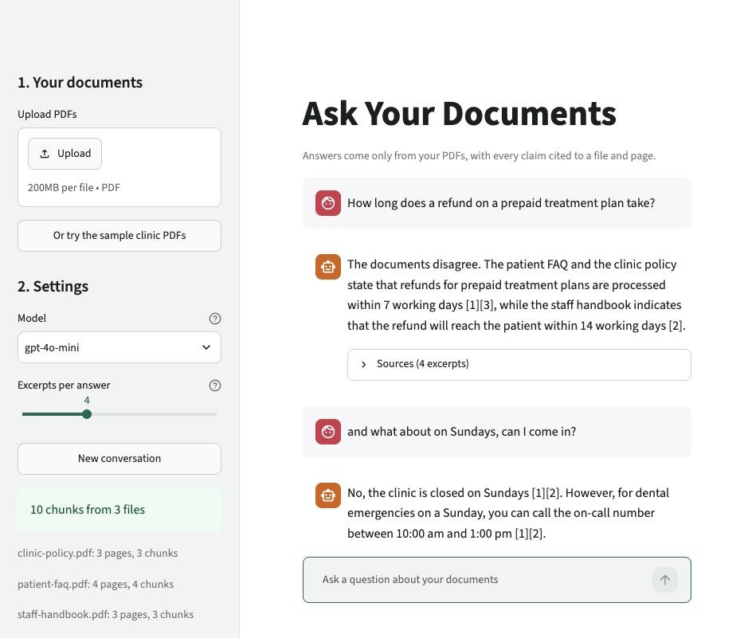
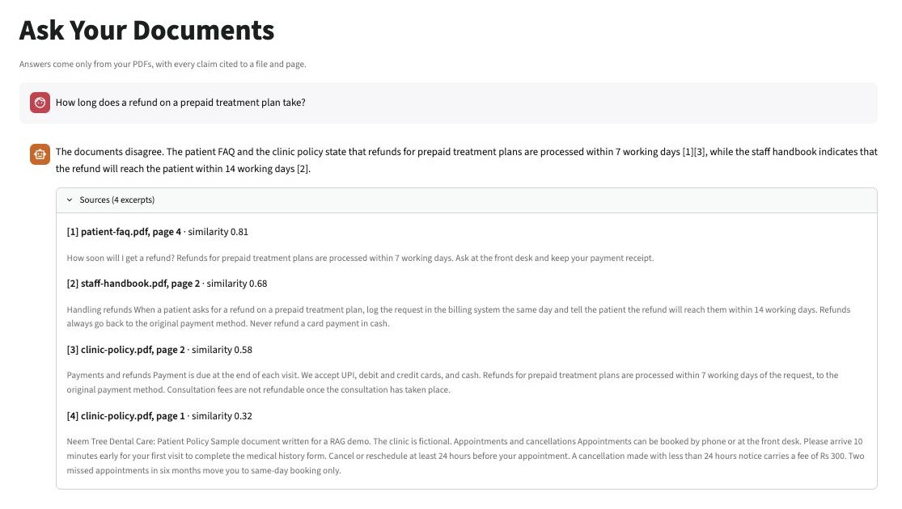

# Week 2 project: Ask Your Documents

A chat app that answers questions from your own PDFs. Every claim in an answer carries a numbered citation, and each citation opens to the file, page and exact passage it came from. It builds on the Day 4 multi-PDF RAG app with a chat interface, follow-up questions, streaming answers and a structured prompt.



## What it does

- **Upload PDFs**, or press **Or try the sample clinic PDFs** to load three test documents.
- **Ask in a chat.** The answer streams in as it is written.
- **Follow-up questions work.** "And on Sundays?" is first rewritten into a standalone question, which the page shows as "Searched for: ...", and that is what gets searched.
- **Citations you can check.** Each answer cites excerpts as [1], [2]. The Sources panel under it shows each excerpt with its file, page, similarity score and text.
- **Disagreement is reported, not hidden.** When two documents say different things, the answer says so and cites both.
- **Settings:** choose the model (gpt-4o-mini or gpt-4o) and how many excerpts to retrieve (2 to 8). **New conversation** clears the chat.
- **Clear errors:** a missing API key, a failed model call or a PDF with no readable text each give a plain message instead of a crash.



## How it works

```
PDFs -> pages (file name, page number) -> chunks of 1,000 characters
     -> OpenAI text-embedding-3-small -> FAISS index

Question -> [rewrite to standalone, if a follow-up] -> top k chunks
         -> answer prompt with numbered excerpts -> streamed, cited answer
```

This is prompt chaining from Day 1: one small call turns a follow-up into a searchable question, and a second call writes the answer.

### The answer prompt

`prompts.py` uses the RTCFR structure from Day 1:

| Part | What it says |
|---|---|
| Role | A careful research assistant that never uses outside knowledge |
| Task | Use every relevant excerpt; report disagreements; give indirect answers; a fixed reply when nothing applies |
| Context | How excerpts are tagged and how to cite them |
| Few-shot | Two worked examples: a disagreement and an indirect answer |
| Response | Plain prose, at most 5 sentences, no preamble |

The indirect-answer rule comes from the Day 4 runs. With a strict "say Not found" rule, the model refused "Can I see a dentist on a Sunday?" although the documents say the clinic is closed and give an on-call number.

## Run it

```
python3 -m venv venv
source venv/bin/activate
pip install -r requirements.txt
cp .env.example .env        # then put your OpenAI key in .env
streamlit run app.py
```

Run the tests with `pytest`. They use a fake embedding model and a fake chat model, so they need no API key.

## How the code is laid out

| File | Role |
|---|---|
| `prompts.py` | The answer prompt and the follow-up rewrite prompt |
| `rag.py` | PDF loading, chunking, index, retrieval with cosine similarity, the two chain steps. No Streamlit. |
| `app.py` | The page: sidebar, chat, streaming, sources panel, errors |
| `test_rag.py` | 10 offline tests: indexing, empty files, retrieval order, citation format, rewrite skipped on the first question and used on a follow-up, streaming, similarity range, weak matches dropped, prompt sections |
| `sample-pdfs/` | Three short PDFs for a fictional dental clinic, with one planted disagreement on refund time |

## Tested

- `pytest`: 10 passed.
- Browser, 19 Nov 2026, sample PDFs (10 chunks from 3 files), gpt-4o-mini, 4 excerpts:
  - "How long does a refund on a prepaid treatment plan take?" The answer said the documents disagree: 7 working days in the FAQ and the clinic policy, 14 in the staff handbook, each cited.
  - Follow-up "and what about on Sundays, can I come in?" was searched as "Can I come in on Sundays?". The answer: closed on Sundays, with the on-call number from 10 am to 1 pm, cited to the handbook and the FAQ.
